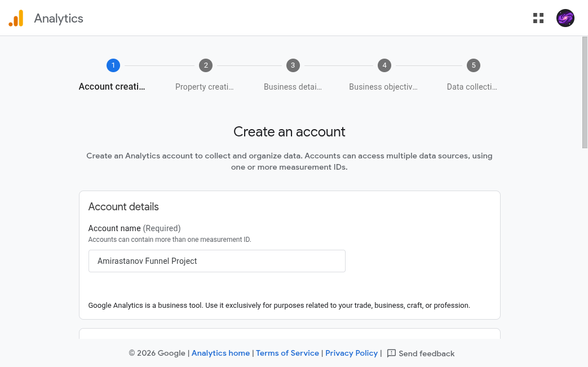
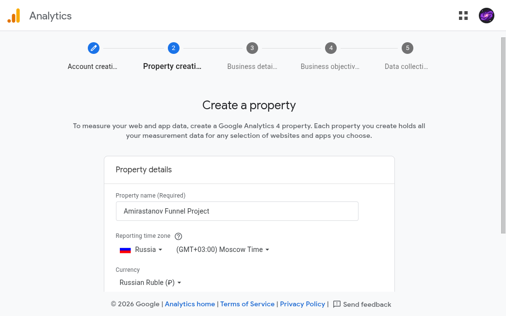
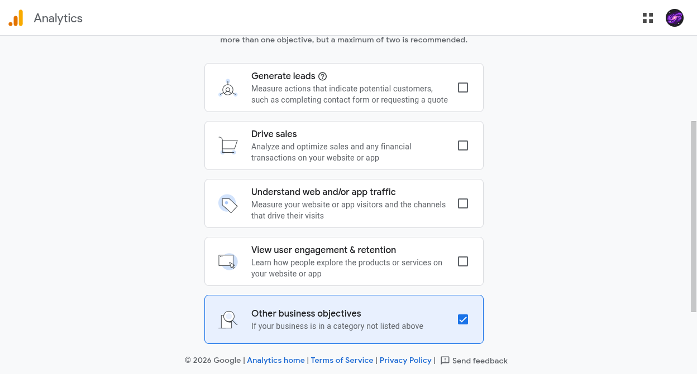
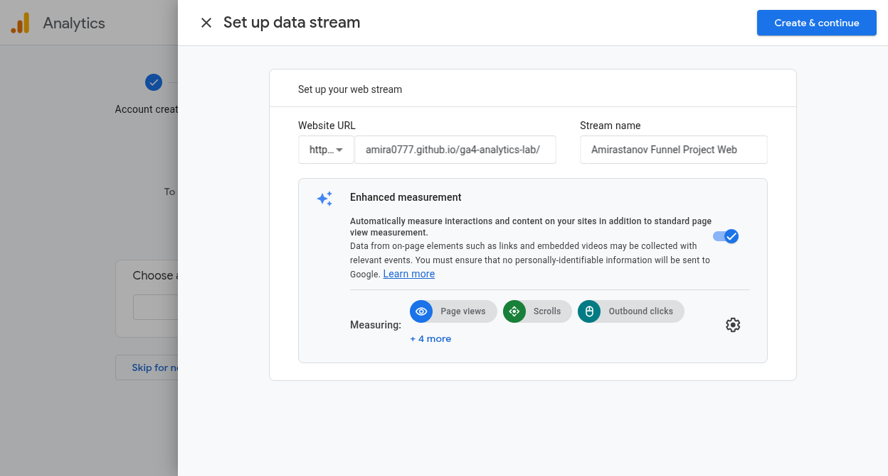
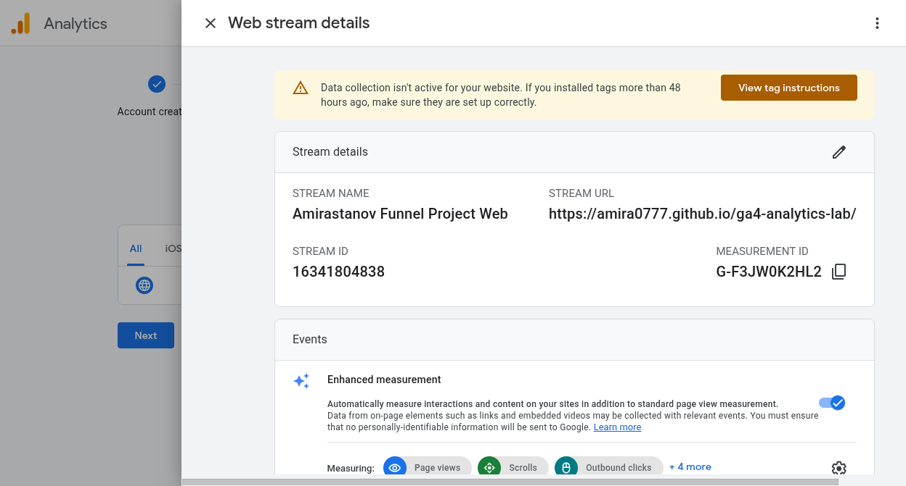

# Домашняя работа № 2 · Где бизнес теряет клиентов

**Дисциплина:** ОП.03 «Информационные технологии»

| Поле | Значение |
|---|---|
| Фамилия, имя, отчество | Амиростанов Аллахверди |
| Группа | РПО1 |
| Номер работы | 2 |
| Тема работы | Анализ воронки цифрового продукта и структура Google Analytics 4 |
| Дата выполнения | 14 ноября 2026 г. |

# Часть 1. Исследование воронки

## 1.1. Объект исследования

| Поле | Значение |
|---|---|
| Компания, сервис или отрасль | Российская интернет-торговля |
| Адрес | Не один сайт: анализируется общая модель интернет-магазина |
| Целевое действие | Успешная оплата заказа |
| Почему выбран этот объект | Путь от рекламного перехода до заказа можно разбить на измеримые этапы и сопоставить с опубликованными российскими кейсами |

## 1.2. Воронка

| № | Этап | Что считается переходом дальше | Метрика этапа |
|---|---|---|---|
| 1 | Переход из рекламы, поиска или другого источника | Посадочная страница успешно загрузилась | Сеансы с посадочной страницы; доля отказов |
| 2 | Просмотр категории или результатов поиска | Открыта карточка товара | Доля сессий с `view_item` от сессий с просмотром списка |
| 3 | Просмотр карточки товара | Товар положен в корзину | Конверсия `view_item` → `add_to_cart` |
| 4 | Корзина и начало оформления | Заполнены обязательные данные и выбран способ доставки | Конверсия `begin_checkout` → `add_shipping_info` |
| 5 | Оплата и подтверждение заказа | Заказ успешно создан и оплачен | Конверсия `begin_checkout` → `purchase`; доля ошибок оплаты |

Это схема для анализа, а не статистика конкретного магазина: собственные
данные о конверсии интернет-магазина в этой работе недоступны.

## 1.3. Источники

### Источник 1

| Поле | Значение |
|---|---|
| Название | Cart Abandonment Rate Statistics |
| Автор или организация | Baymard Institute |
| Дата | Страница приводит исследования за 2006–2025 годы; дата публикации страницы не указана |
| Ссылка | [baymard.com/blog/cart-abandonment-rate](https://baymard.com/blog/cart-abandonment-rate) |

**Выписка:** среднее по 50 опубликованным исследованиям — 70,22% брошенных
корзин; среди названных причин 40% респондентов указали дополнительные
расходы, а 17% — слишком долгий или сложный процесс оформления.

**Связь с воронкой:** это ориентир для этапов корзины и оформления, но не
оценка российских магазинов. Значительная часть таких отказов может быть
обычным просмотром и сравнением товаров; показатель нельзя переносить на
отдельный магазин без его собственных данных.

**Цифры и этап:** 70,22% — среднее по набору исследований; 40% и 17% —
указанные причины отказа от заказа. Относятся к корзине/checkout.

### Источник 2

| Поле | Значение |
|---|---|
| Название | Digital 2024: The Russian Federation |
| Автор или организация | DataReportal, We Are Social и Meltwater |
| Дата | 2024 |
| Ссылка | [datareportal.com/reports/digital-2024-russian-federation](https://datareportal.com/reports/digital-2024-russian-federation) |

**Выписка:** в начале 2024 года оценивалось 130,4 млн интернет-пользователей
в России; проникновение интернета — 90,4%.

**Связь с воронкой:** цифры дают общий контекст цифровой аудитории, но не
показывают конверсию покупок или причины отказов.

**Цифры и этап:** 130,4 млн и 90,4% — охват интернет-аудитории; это контекст
для этапа привлечения, не метрики отдельного магазина.

### Источник 3

| Поле | Значение |
|---|---|
| Название | About events |
| Автор или организация | Google Analytics Help |
| Дата | На странице не указана |
| Ссылка | [support.google.com/analytics/answer/9322688](https://support.google.com/analytics/answer/9322688?hl=en) |

**Выписка:** события описывают действия пользователя; отчёт Realtime позволяет
проверять события за последние 30 минут, а DebugView — последовательность
событий отдельного пользователя в режиме отладки.

**Связь с воронкой:** этапы нужно определять через события и их параметры,
проверяя, что событие действительно отправляется. Документация также
предупреждает об ограничении размера передаваемых событий и пакетировании.

**Цифры и этап:** 30 минут — окно Realtime; конверсию российского рынка
источник не измеряет.

### Источник 4

| Поле | Значение |
|---|---|
| Название | Кейс E96. Результаты работы за 4 месяца |
| Автор или организация | Mindbox; клиент — российский интернет-магазин E96 |
| Дата | 15 апреля 2016 г. |
| Ссылка | [mindbox.ru/journal/cases/e96](https://mindbox.ru/journal/cases/e96/) |

**Выписка:** после переноса email-механик E96 добавил второе письмо в цепочку
брошенной корзины; публикация сообщает о дополнительных 15% заказов.

**Связь с воронкой:** пример работы с пользователями, остановившимися между
корзиной и покупкой. Это результат опубликованного кейса поставщика сервиса,
а не независимый контролируемый эксперимент.

**Цифры и этап:** +15% заказов — заявленный результат добавления второго
письма; методика расчёта и период сравнения в статье подробно не раскрыты.

### Источник 5

| Поле | Значение |
|---|---|
| Название | Как Book24 персонализировали рассылки на 3 млн руб. в месяц дополнительно |
| Автор или организация | Mindbox; клиент — книжный интернет-магазин Book24 |
| Дата | 8 августа 2018 г. |
| Ссылка | [mindbox.ru/journal/cases/book24-rassylki](https://mindbox.ru/journal/cases/book24-rassylki/) |

**Выписка:** кейс описывает объединение профилей покупателей, сегментацию и
более 25 новых триггеров; авторы сообщают о 3 млн рублей дополнительной
ежемесячной выручки email-канала за полгода и о 2,5 тыс. заказов с новых
триггеров за год.

**Связь с воронкой:** персональные рекомендации и триггерные письма могут
возвращать покупателя на сайт и поддерживать повторную покупку. Показатели
представлены самим поставщиком решения и не доказывают, что весь рост вызван
только одним изменением.

**Цифры и этап:** 3 млн рублей в месяц и 2,5 тыс. заказов — заявленные
результаты email-коммуникаций; относятся к возврату и повторной покупке.

## 1.4. Реальные кейсы

### Кейс 1 — E96

| № | Пункт | Ответ |
|---|---|---|
| 1 | Компания, продукт или рынок | E96, российский магазин бытовой техники и электроники |
| 2 | Участок воронки | Корзина → завершённый заказ |
| 3 | Проблема | Часть покупателей оставляла корзину незавершённой |
| 4 | Подтверждение | В статье описана действующая цепочка брошенной корзины; исходные доли отказа не опубликованы |
| 5 | Изменение | Добавили второе письмо в цепочку |
| 6 | Результат | Кейс заявляет дополнительные 15% заказов; метод расчёта и контрольная группа не описаны |
| 7 | Можно ли перенести | Идею триггера можно тестировать в другом магазине, но результат E96 нельзя считать прогнозом для него |

**Источник:** [кейс E96 на сайте Mindbox](https://mindbox.ru/journal/cases/e96/).

### Кейс 2 — Book24

| № | Пункт | Ответ |
|---|---|---|
| 1 | Компания, продукт или рынок | Book24, российский книжный интернет-магазин |
| 2 | Участок воронки | Повторный контакт с посетителем/покупателем → переход на сайт → заказ |
| 3 | Проблема | Нерелевантные массовые письма и разрозненные данные затрудняли персонализацию |
| 4 | Подтверждение | В кейсе описаны четыре базы магазинов и потребность в сегментации; исходные конверсии всей воронки не приведены |
| 5 | Изменение | Объединили профили, запустили сегментированные рассылки и более 25 триггеров, часть — с A/B-тестами |
| 6 | Результат | Публикация сообщает о 3 млн рублей дополнительной месячной выручки email-канала за полгода и 2,5 тыс. заказов с новых триггеров за год; причинность отдельно не проверена |
| 7 | Можно ли перенести | Сегментацию и триггеры можно проверить на собственном трафике; цифры Book24 нельзя переносить напрямую |

**Источник:** [кейс Book24 на сайте Mindbox](https://mindbox.ru/journal/cases/book24-rassylki/).

## 1.5. Возможные причины потери пользователей

| № | Этап | Возможная причина | Подтверждение |
|---|---|---|---|
| 1 | Корзина → оформление | Дополнительные расходы на доставку, налоги или сборы становятся известны поздно | Baymard приводит эту причину среди ответов в исследованиях; проверить её долю нужно на данных своего магазина |
| 2 | Начало оформления → заказ | Слишком длинная форма или сложный checkout | Baymard указывает на эту причину; число брошенных шагов нужно измерить по событиям |
| 3 | Карточка/корзина → покупка или повторный визит | Не хватает релевантного напоминания или предложения | Кейсы E96 и Book24 показывают использование триггеров; сами по себе они не доказывают, что это главная причина потерь у другого магазина |

## 1.6. Гипотезы улучшения

| № | Этап | Гипотеза | Какие данные собрать | Как проверить |
|---|---|---|---|---|
| 1 | Корзина → оформление | Если показать стоимость и срок доставки до начала checkout, доля брошенных корзин снизится | `add_to_cart`, показ цены доставки, `begin_checkout`, `purchase`, регион доставки | A/B-тест; сравнить конверсию и средний чек, отдельно контролировать отмены |
| 2 | Checkout → покупка | Если сократить обязательные поля и явно показывать ошибки, больше пользователей завершат оформление | Переходы по шагам, ошибки валидации, время заполнения, `purchase` | A/B-тест короткой и текущей формы; оценить конверсию и долю ошибочных заказов |
| 3 | Брошенная корзина → возврат | Одно своевременное напоминание с сохранённой корзиной повысит число заказов без чрезмерных скидок | Согласие на сообщения, доля доставленных писем, переходы, покупки и отписки | Случайно разделить подходящую аудиторию на тест/контроль; сравнить инкрементальные покупки и отписки |

# Часть 2. Google Analytics 4

## 2.1. Выполнение шагов

Ресурс и веб-поток настроены в личном Google-аккаунте. Условия Google
просмотрел и принял владелец аккаунта.

| № | Шаг | Выполнено |
|---|---|---|
| 1 | Вход в Google Analytics под личным аккаунтом | да |
| 2 | Создание Analytics Account | да |
| 3 | Создание Property | да |
| 4 | Часовой пояс, валюта и сведения о проекте | да: Москва (UTC+03:00), RUB |
| 5 | Выбор бизнес-целей | да: Other business objectives |
| 6 | Создание ресурса | да |
| 7 | Создание Web Data Stream | да |
| 8 | Проверка URL, имени потока и Enhanced Measurement | да |
| 9 | Создание потока | да |
| 10 | Получение Measurement ID | да |

## 2.2. Результат настройки

| Поле | Значение |
|---|---|
| Analytics Account | Amirastanov Funnel Project |
| Property | Amirastanov Funnel Project |
| Reporting time zone | Russia — (GMT+03:00) Moscow Time |
| Currency | Russian Ruble (RUB) |
| Бизнес-цели | Other business objectives |
| Stream name | Amirastanov Funnel Project Web |
| Website URL | https://amira0777.github.io/ga4-analytics-lab/ |
| Stream ID | 16341804838 |
| Measurement ID | `G-F3JW0K2HL2` |
| Enhanced Measurement | включено |

Тег на сайте не устанавливал: это отдельное задание 3. После создания поток
показывал «No data received» и предупреждение, что сбор данных не активен,
что ожидаемо до установки Google Tag. Контрольный запрос к Pages URL из этой
среды вернул HTTP 503; доступность сайта в браузере владельца отдельно не
подтверждена, поэтому после открытия проверьте URL.

## 2.3. Скриншоты

## Использование ИИ

ИИ использовался для поиска и структурирования материалов и помог разобраться с гуглом и его G4A.
