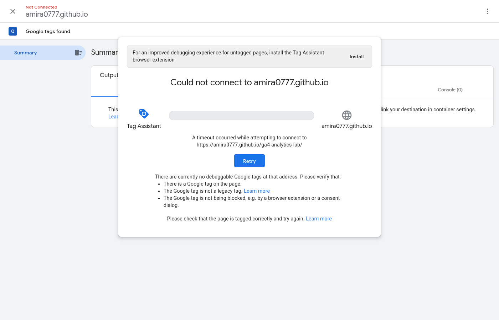
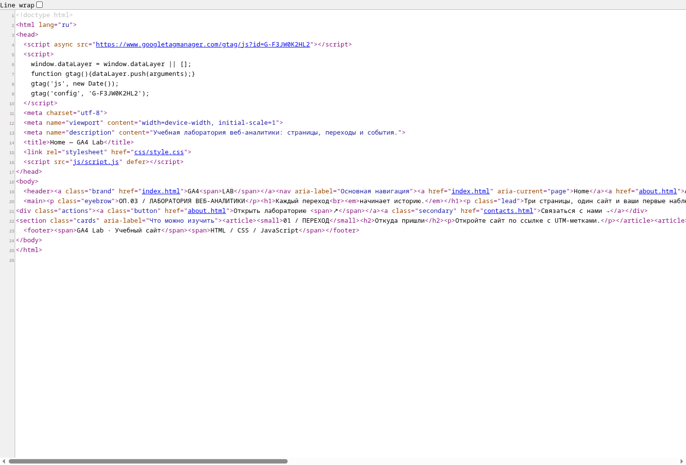
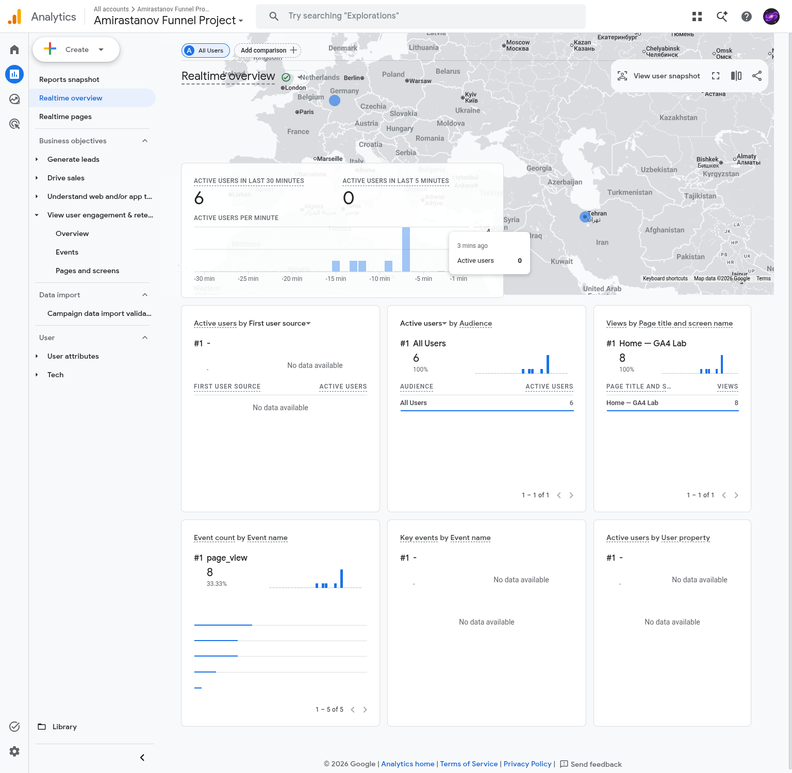
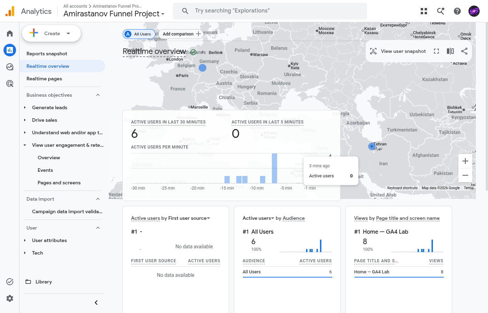
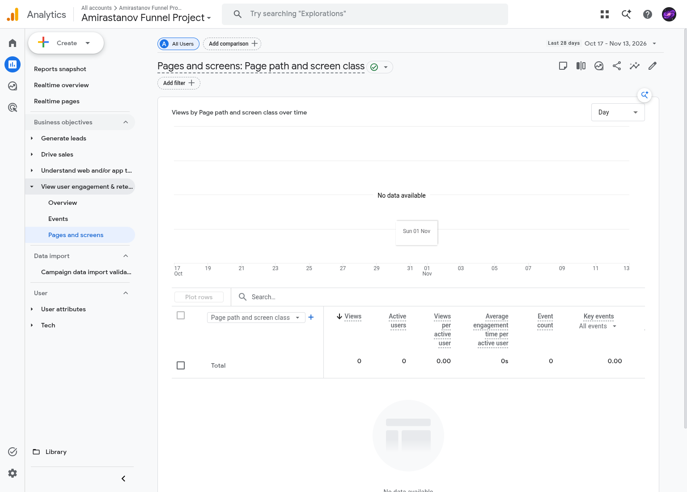

# Домашняя работа № 3 · Тег на сайте, источник и отчёты GA4

**Дисциплина:** ОП.03 «Информационные технологии»

| Поле | Значение |
|---|---|
| Фамилия, имя, отчество | Амиростанов Аллахверди |
| Группа | РПО1 |
| Номер работы | 3 |
| Тема работы | Установка Google Tag, источник перехода и отчёты GA4 |
| Дата сдачи | 31 октября |

---

## 1. Мой сайт и мой ресурс

| Поле | Значение |
|---|---|
| Адрес репозитория сайта | [github.com/amira0777/ga4-analytics-lab](https://github.com/amira0777/ga4-analytics-lab) |
| Публичный адрес сайта | [https://amira0777.github.io/ga4-analytics-lab/](https://amira0777.github.io/ga4-analytics-lab/) |
| Статус публикации | READY (GitHub Pages) |
| Analytics Account | Amirastanov Funnel Project |
| Property | Amirastanov Funnel Project |
| Stream name | Amirastanov Funnel Project Web |
| Stream ID | 16341804838 |
| Website URL в потоке | https://amira0777.github.io/ga4-analytics-lab/ |
| Measurement ID (`G-…`) | `G-F3JW0K2HL2` |
| Страницы с тегом | `index.html`, `about.html`, `contacts.html` — по одному тегу на странице |

Тег ставится на каждую страницу по одному разу: две копии дают двойные
события.

## 2. Тег установлен

**Результат проверки из инструкции тега:**

Проверка Tag Assistant не завершилась: сервис сообщил `Could not connect`,
`Not Connected` и `0 Google tags found`. Поэтому положительный результат
этой проверки не подтверждён. При этом ниже приведён реальный исходный код
опубликованной страницы, а GA4 Realtime получил события `page_view`.





## 3. События доходят до аналитики

| Поле | Значение |
|---|---|
| Дата и время проверки | 14 ноября 2026 г.; точное время на кадре не отображается |
| Какие страницы открывали | `Home — GA4 Lab` по публичному адресу сайта |
| Какие события появились в Realtime | `page_view` — 8, `first_visit` — 6, `session_start` — 6, `scroll` — 3, `user_engagement` — 1 |
| Число активных пользователей в момент проверки | 6 за последние 30 минут; 0 за последние 5 минут на кадре |



## 4. Источник перехода определился

Ссылка собирается с метками `utm_source`, `utm_medium`, `utm_campaign`
и открывается на своём сайте.

**Ссылка целиком:**

```
https://amira0777.github.io/ga4-analytics-lab/?utm_source=telegram&utm_medium=social&utm_campaign=hw03_check
```

| Поле | Значение |
|---|---|
| Где в GA4 виден источник | Realtime → Active users by First user source |
| Какое значение источника показал GA4 | Не отображается: `No data available` |
| Совпадает с `utm_source` из ссылки | Пока нельзя подтвердить |



При загрузке страницы `page_view` отправлялся с указанным UTM-адресом. Это
подтверждает посещение размеченной ссылки, но не подтверждает, что GA4 уже
определил и показал `telegram` как источник.

Источник и кампания из UTM в отчёте Realtime не показываются: эти измерения
вычисляются при обработке данных. Если в Realtime источника нет, смотрите
отчёт по источникам трафика в разделе «Отчёты».

## 5. Статистика на странице «Отчёты»

| Показатель | Значение | Период |
|---|---|---|
| Пользователи | Нет данных (в итогах интерфейса отображается 0) | Last 28 days, 17 октября — 13 ноября 2026 |
| Сеансы | Нет данных | Last 28 days, 17 октября — 13 ноября 2026 |
| События | Нет данных (в итогах интерфейса отображается 0) | Last 28 days, 17 октября — 13 ноября 2026 |
| Самое частое событие | Не определено | Last 28 days, 17 октября — 13 ноября 2026 |



**Что видно по этим числам** (2–3 предложения):

В стандартном отчёте GA4 за выбранный период показаны нулевые итоги и
`No data available`; это не доказывает, что посещений не было. События видны
в Realtime, поэтому отчёт нужно проверить повторно после обработки данных,
выбрав период, включающий 14 ноября.

## 6. Что не получилось

Если какой-то шаг не заработал, напишите какой, какое сообщение показал сервис
и что было проверено по таблице из `README.md`. Незаполненный раздел означает,
что всё получилось.

Tag Assistant завершился тайм-аутом и не подтвердил установку тега. Источник
`telegram` пока не появился в Realtime, а стандартный отчёт за 17 октября —
13 ноября пуст; проверки и ограничения отражены на приложенных кадрах.
Подменять эти результаты успешными не стал.

## 7. Использование ИИ

Тег вы устанавливаете, проверяете и снимаете кадры сами. ИИ допускается
для формулировок и оформления.

| Вопрос | Ответ |
|---|---|
| Что сделано самостоятельно | Авторизовался в GA4, подтвердил создание ресурса и публикацию сайта, открыл размеченную ссылку |
| Что спрошено у модели | Помощь с установкой Google Tag и оформлением отчёта |
| Что после этого изменено | Google Tag добавлен на три HTML-страницы; проверены исходный код и Realtime. Атрибуция источника и стандартный отчёт оставлены незавершёнными до появления данных |
