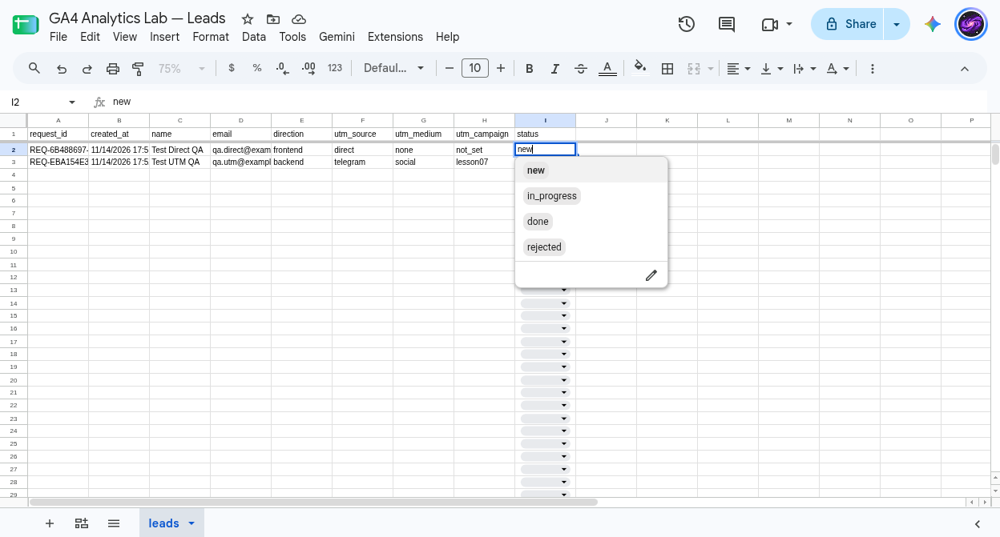
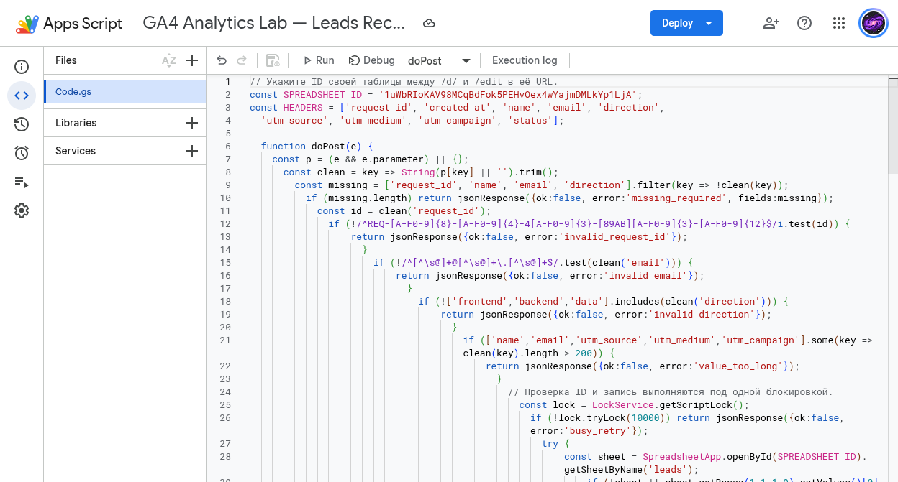
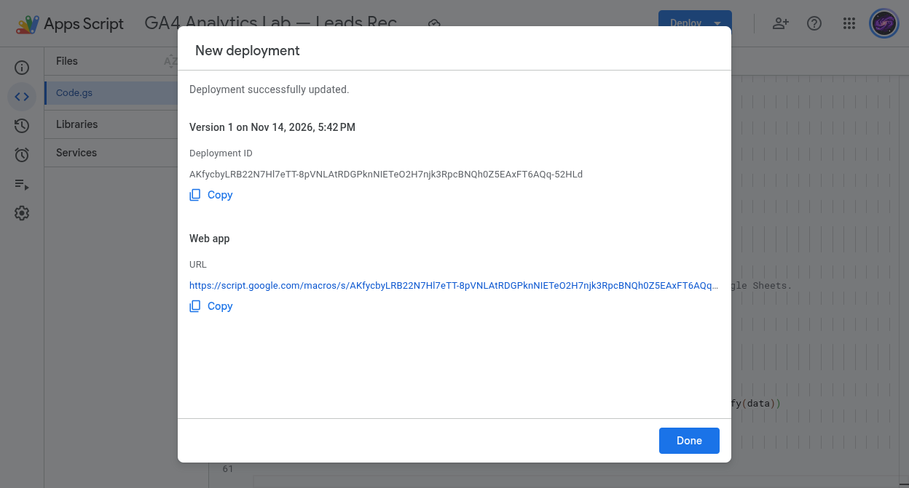
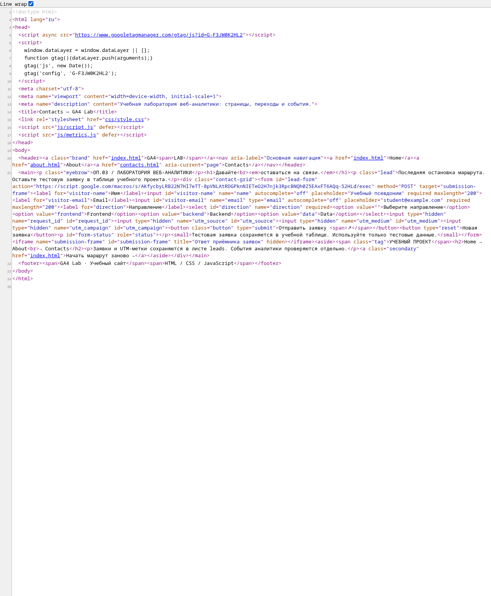
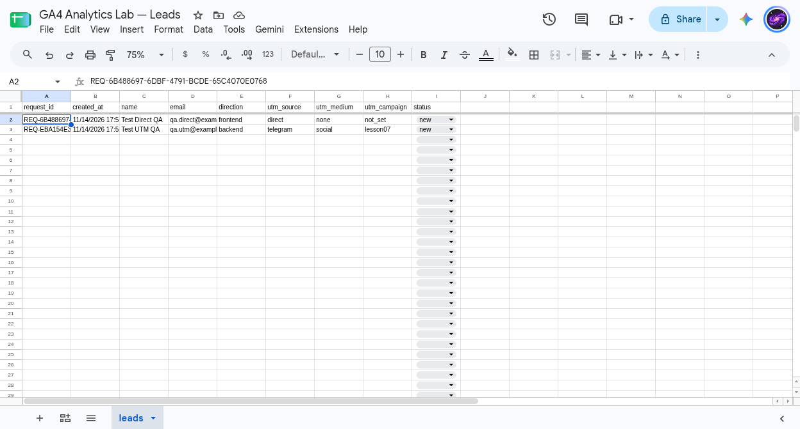
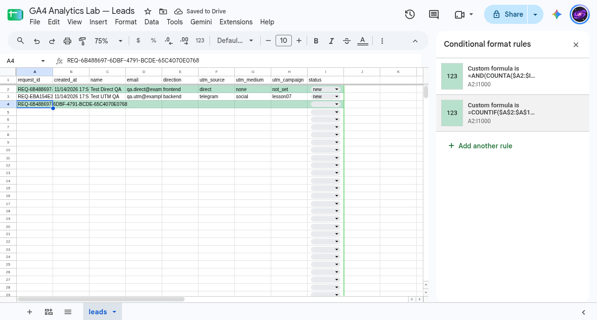
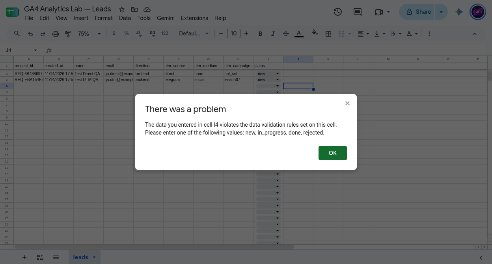

# Домашняя работа № 5 · Контролируемая таблица заявок

**Дисциплина:** ОП.03 «Информационные технологии»

| Поле | Значение |
|---|---|
| Фамилия, имя, отчество | Амиростанов Аллахверди |
| Группа | РПО1 |
| Номер работы | 5 |
| Тема работы | Форма сайта → Apps Script → Google Таблица заявок |
| Дата сдачи | 31 октября |

Отчёт заполнен по фактическим результатам и приложенным скриншотам.

---

## 1. Таблица

Я создал таблицу «GA4 Analytics Lab — Leads» с листом `leads`. В первой
строке девять заголовков: `request_id`, `created_at`, `name`, `email`,
`direction`, `utm_source`, `utm_medium`, `utm_campaign`, `status`. Строка
заголовков закреплена, у статуса список из четырёх значений: `new`,
`in_progress`, `done`, `rejected`. Два правила подсвечивают неполную строку
и повторный `request_id`.

Ссылка на таблицу: https://docs.google.com/spreadsheets/d/1uWbRIoKAV98MCqBdFok5PEHvOex4wYajmDMLkYp1LjA/edit

## 2. Приёмник и форма

Я вставил `Code.gs` из материалов в Apps Script, указал ID своей таблицы
и опубликовал проект как Web app. Форму в `contacts.html` заменил
фрагментом из материалов, в `action` поставил адрес своего Web app,
обработчик формы в `js/script.js` заменил новым.

| Мои данные | Значение |
|---|---|
| Публичный адрес сайта | https://amira0777.github.io/ga4-analytics-lab/ |
| Measurement ID (`G-…`) | `G-F3JW0K2HL2` |
| Коммит с новой формой (первые 7 символов) | `0a80680` |

## 3. Две тестовые заявки

Первую заявку я отправил со страницы без меток: в таблице записалось
`direct` / `none` / `not_set` и статус `new`. Вторую отправил по ссылке
с метками `telegram` / `social` / `lesson07`, и они записались в свои
столбцы.

| | Заявка без меток | Заявка с метками |
|---|---|---|
| `request_id` | `REQ-6B488697-6DBF-4791-BCDE-65C4070E0768` | `REQ-EBA154E3-C762-4BDE-9F83-99F85D9D9BC0` |

## 4. Событие в аналитике

При тестовой отправке браузер сформировал `generate_lead` и отправил запрос
сбора GA4; строка в таблице подтверждает приём заявки. В Realtime и
DebugView событие не отобразилось, поэтому получение события ресурсом GA4
не подтверждено.

Скриншот GA4 не приложен: подтверждённого события в Realtime или DebugView нет.

## 5. Проверки

Форма не приняла пустое обязательное имя; повторный `request_id` не создал
новую запись. Временная копия строки подсветилась и после снимка была
удалена. Значение `finished` отвергнуто правилом проверки. Через список
статусов проверена последовательность `new` → `in_progress` → `done`, затем
значение возвращено к `new`, чтобы не оставлять тестовую заявку изменённой.

---

Не удалось подтвердить `generate_lead` в интерфейсе GA4. Остальные проверки
формы и таблицы описаны выше.

ИИ использован для оформления отчёта.
