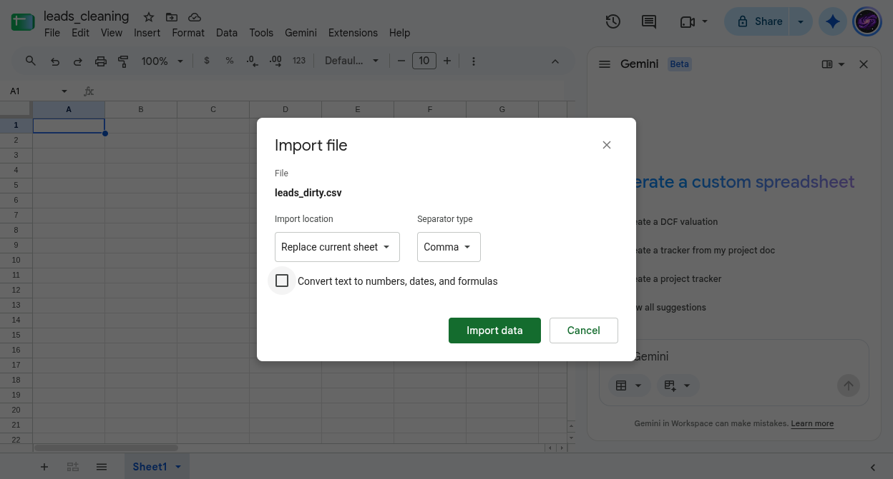
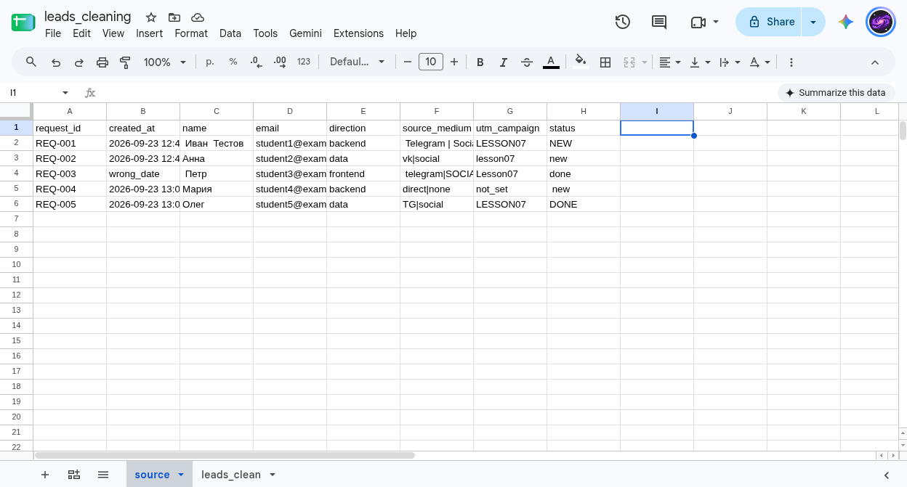
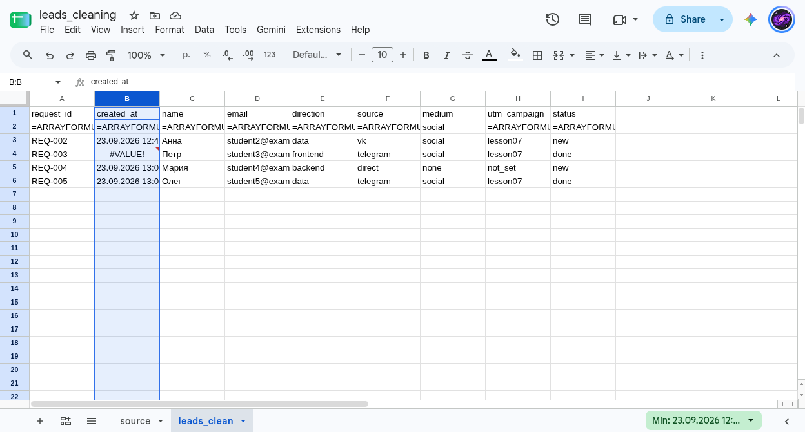
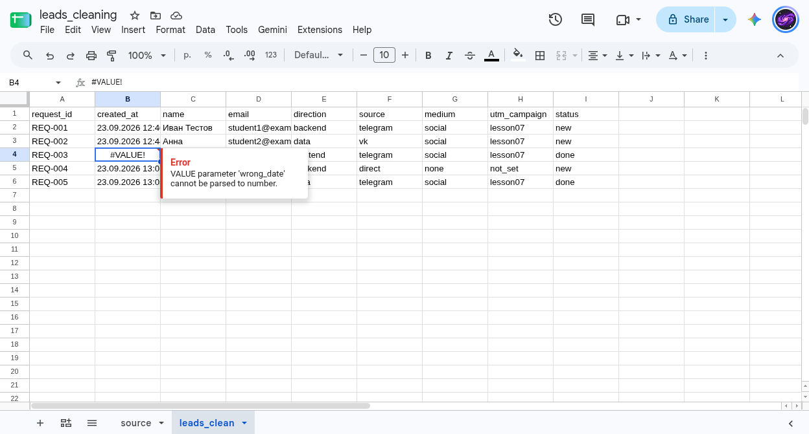
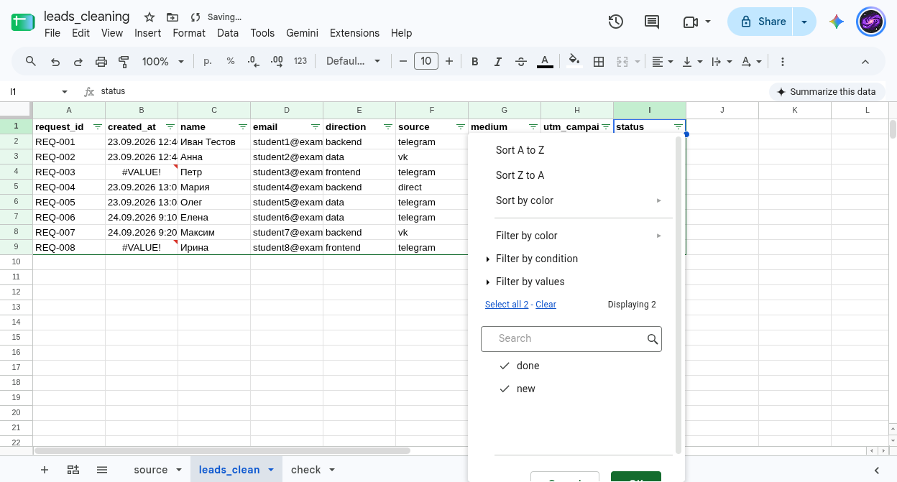
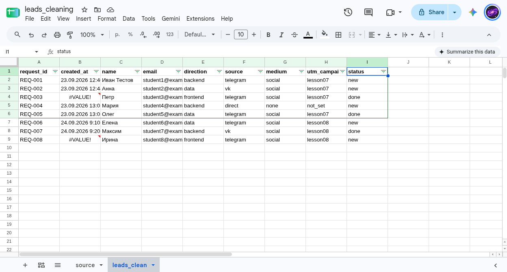
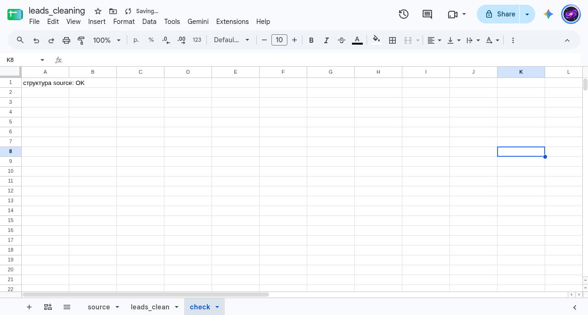

# Домашняя работа № 6 · Подготовка данных

**Дисциплина:** ОП.03 «Информационные технологии»

| Поле | Значение |
|---|---|
| Фамилия, имя, отчество | Амиростанов Аллахверди |
| Группа | РПО1 |
| Номер работы | 6 |
| Тема работы | Подготовка и проверка выгрузки заявок в Google Таблицах |
| Дата выполнения | 31 октября |

## 1. Исходные данные

Для работы создана таблица `leads_cleaning`. CSV `leads_dirty.csv`
импортирован на лист `source` без автоматического преобразования типов.
Затем на этот же лист импортирована версия `leads_dirty_v2.csv`.

Ссылка на таблицу:
https://docs.google.com/spreadsheets/d/16_28bDImqJ1eAkq0_4rLNW3HDLHz16O3qdnmoDkW-lE/edit

## 2. Очистка данных

На листе `leads_clean` настроены формулы для нормализации текстовых полей,
разделения источника и канала, очистки пробелов и приведения значений к
единому виду. Для `created_at` установлен формат даты и времени. Формулы
сохраняются на листе; исходный `source` не редактировался.

В некорректных датах таблица показывает `#VALUE!`; ошибка не скрывалась и
значения не заменялись фиктивной датой.

После очистки фильтр `status` содержит `done` и `new`.

## 3. Проверка второй выгрузки

После импорта v2 формулы обработали восемь записей. Контрольные строки:

| `request_id` | Проверенный результат |
|---|---|
| `REQ-006` | Елена / telegram / social / lesson08 / new |
| `REQ-007` | Максим / vk / social / lesson08 / done |
| Ошибочные даты | `REQ-003` и `REQ-008` — `#VALUE!` |

На листе `check` проверка структуры источника вернула `структура source: OK`.

## 4. Результат

Лист `leads_clean` выгружен в CSV после импорта v2 и сохранён как
`leads_clean.csv` в этой папке.

- Строк данных: 8.
- Столбцов: 9.
- Некорректные даты отмечены как `#VALUE!`.
- Листы `source`, `leads_clean` и `check` сохранены в Google Таблице.

ИИ использован для оформления отчёта.
